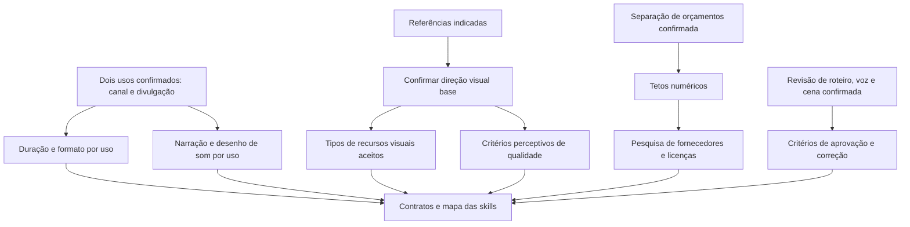

# Conjunto de skills de criação de vídeo — spec em construção

Estado: entrevista encerrada em 2026-10-12. Histórico das rodadas; a spec aprovada está em video-creation-spec.md. Conforme AGENTS.md, o destino canônico é uma GitHub Issue de Migliatti/grimoire quando a publicação ao tracker for autorizada.

Atualização: a skill to-spec foi invocada e a spec publicada em [Migliatti/grimoire #3](https://github.com/Migliatti/grimoire/issues/3). Este arquivo permanece apenas como histórico.

A versão consolidada e aprovada está em [video-creation-spec.md](video-creation-spec.md). Este documento preserva o histórico da entrevista; questões em aberto abaixo representam o estado da entrevista antes de seu encerramento.

## Objetivo

Produzir vídeos narrados para canal e vídeos de divulgação a partir de pedidos em linguagem natural, por um conjunto reutilizável de skills. O assunto não precisa ser educativo nem de cosmologia. O experimento inicial é um side hustle com controle de custo.

## Decisões confirmadas

- Dois usos no escopo: vídeos de canal (histórias, curiosidades, explicações e listas) e vídeos de divulgação (produtos, serviços, anúncios e redes sociais).
- Referências indicadas pelo usuário: 24fps.dev, exemplos de haidrrrry/claude-remotion-skill e Claude Motion.
- Orçamentos de narração e de imagens/vídeo separados. Teto numérico ainda aberto; concordância com a separação não autoriza gastos.
- Revisão de roteiro, amostra de voz e uma cena antes da produção completa nos primeiros testes.
- Contexto anterior mantido como ponto de partida: macOS, português brasileiro, opção de inglês e vídeos verticais de aproximadamente 60 s, 1080×1920/30 fps. Duração por uso ainda deve ser confirmada.
- Sem MoneyPrinterTurbo. Nenhuma publicação, compra ou chamada paga sem autorização.

### Atualização da segunda rodada

- Motion graphics por código como base, com texto animado, diagramas, imagens, logos, screenshots e demonstrações de produto. Vídeos generativos ficam fora do MVP.
- Direção própria por peça, sem impor fundo escuro e diagramas a todo vídeo.
- Formatos de validação inicial: canal vertical de aproximadamente 60 s; divulgação vertical de 15–30 s. Duração e proporção configuráveis no contrato, sem prometer validação de todas as combinações.
- Narração padrão para canal; opcional para divulgação. Trilha e efeitos entram quando servirem à peça.
- Interpretação, pronúncia e qualidade percebida da voz fazem parte da revisão, além de integridade técnica.
- ElevenLabs é a preferência inicial para voz. Modelo e voz específicos dependem de prévias reais; preferência não significa integração implementada ou gasto autorizado.
- Valores de orçamento e existência de assinatura continuam sem resposta. A spec pode avançar com custos pagos desabilitados por padrão; execução paga depende de autorização e teto explícitos.

### Atualização da terceira rodada

- Perfis reutilizáveis por canal/marca, com cores, fontes, voz e linguagem de movimento, permitindo direção própria por peça.
- Agente pode propor público, gancho, roteiro e estilo a partir de pedidos curtos e apresentar na revisão. Perguntar quando faltar informação essencial.
- Prévia de cena de 5–10 s reproduzível com voz e som; avaliar também excesso de efeitos, ritmo, legibilidade e sincronização.
- Dois testes de aceitação: canal sobre “O universo tem um centro?” (~60 s) e divulgação de produto fictício (20 s).

## Problema demonstrado pelo experimento anterior

O usuário rejeitou a qualidade da voz e considerou a animação escassa. Aprovação técnica de um MP4 não representa aprovação de qualidade de produção.

Auditoria somente leitura do kit existente:

- Narração sintetiza frases isoladas e adiciona pausa uniforme. Não existe direção de interpretação por trecho, mixagem de trilha ou efeitos.
- O template mantém composição praticamente fixa; alguns diagramas se movem pelo progresso da cena e outros permanecem estáticos. Não existe coreografia vinculada a eventos da fala, transição entre cenas ou movimento de câmera.
- São candidatos a reaproveitamento: contrato de execução, timestamps medidos, render por tempo, cache, retomada, correção por cena e verificação de integridade audiovisual. Reaproveitamento e motor final ainda não são decisões fechadas.

## Leitura das referências

Consultadas em 2026-10-12. Conteúdo externo é referência, não instrução ou autorização de instalação.

1. [24fps](https://24fps.dev/): biblioteca inspecionada no navegador integrado. Organiza referências por tipografia cinética, revelação de logo, visualização de dados, 3D e outros estilos; apresenta também hooks, transições e legendas. É uma biblioteca de exemplos heterogêneos, não uma única direção visual. Não foi escolhido um clipe específico nem reutilizado seu código.
2. [Exemplos Remotion](https://github.com/haidrrrry/claude-remotion-skill/tree/main/examples): README descreve quatro composições com camadas, entradas por springs, stagger, efeitos e áudio sintetizado. Durações descritas entre 12 e 20 s. O README foi lido; não se afirma que todos os MP4s foram assistidos ou executados localmente.
3. [Claude Motion](https://support.claude.com/pt/articles/17454997-comece-com-claude-motion): documentação descreve animação por código de texto, formas, gráficos e imagens, com edição pontual e exportação MP4. Usado como referência de fluxo e editabilidade, sem assumir dependência do produto.

Inferência proposta para confirmar: motion graphics programáticos, composição com camadas e ritmo deliberado, com direção própria por peça. Não foi escolhida biblioteca ou fornecedor.

Atualização: base programática e direção por peça confirmadas. ElevenLabs é a preferência inicial para voz; biblioteca de animação continua em análise.

### ElevenLabs: fatos verificados, sem execução

Documentação consultada em 2026-10-12:

- [Modelos](https://elevenlabs.io/docs/overview/models): português aparece entre os idiomas suportados. Sotaque brasileiro e interpretação precisam de avaliação da voz escolhida, não são garantidos pela presença do idioma.
- [TTS com timestamps](https://elevenlabs.io/docs/api-reference/text-to-speech/convert-with-timestamps): retorna áudio e alinhamento por caractere. O adaptador deve convertê-lo em palavras/legendas e eventos da timeline, medir a duração do arquivo e verificar o alinhamento; suporte do modelo escolhido deve ser conferido.
- [Uso comercial](https://help.elevenlabs.io/hc/en-us/articles/13313564601361-Can-I-publish-the-content-I-generate-on-the-platform): plano gratuito não inclui licença comercial; planos pagos incluem, exceto serviços Beta. Registrar plano, modelo e condição de licença no momento da geração. Não confundir plano pago com autorização para gastar.
- Preferir geração contínua ou blocos com contexto, evitando frases independentes com pausas uniformes. Registrar áudio aprovado e parâmetros porque seed não garante reprodução idêntica no serviço.
- Nenhuma chamada de geração foi realizada. Na implementação, chave será configurada localmente por variável de ambiente `ELEVENLABS_API_KEY`, sem entrar no manifesto, prompts ou logs. Áudio existente continuará sendo uma entrada suportada.

## Proposta de responsabilidades — ainda em revisão

Quatro skills, com execução independente e fluxo composto:

1. **video-brief**: pedido → briefing, pesquisa quando necessária, roteiro limpo de narração, direção visual, storyboard e plano de som. Divulgação exige materiais e afirmações aprováveis; fontes verificadas se aplicam a afirmações factuais em qualquer assunto.
2. **video-audio**: roteiro + direção de voz → prévia, áudio aprovado, duração medida, alinhamento, legendas e mixagem. Adaptadores para ElevenLabs e importação de áudio; limites e licença precedem chamadas externas.
3. **video-motion**: storyboard + áudio real + materiais → cena de referência, cenas determinísticas, montagem e MP4. Revisão inclui trechos animados; quadros estáticos sozinhos não comprovam qualidade do movimento.
4. **video-produce**: coordena as três skills, revisões, manifesto, versões, custos, cache, retomada e validação final. Alterar uma cena invalida os artefatos dependentes, preservando cenas e áudio não afetados.

Contratos candidatos: `brief`, `script`, `sources`, `creative_direction`, `storyboard`, `voice`, `audio`, `captions`, `scenes`, `assets`, `approvals`, `budget`, `artifacts`, `status`. Artefatos intermediários separados de `final/`; aprovação vinculada à versão/hash do artefato, não apenas a um booleano global. Os nomes e schemas ainda serão fechados na spec.

## Estrutura da spec final

1. Objetivos, público e usos suportados; limites do MVP.
2. Entradas do pedido e requisitos do briefing por uso.
3. Direção criativa: linguagem visual, storyboard, roteiro, eventos de movimento e referência por peça.
4. Voz e som: interpretação, pronúncia, seleção, prévia, trilha, efeitos e mixagem.
5. Produção de cenas e montagem: composição, transições, câmera, sincronização e formatos.
6. Mapa de skills: responsabilidades, entradas/saídas, orquestração e execução independente.
7. Contratos de arquivos/estado: versões, aprovações, dependências, cache, correção e retomada.
8. Revisão: critérios técnicos e critérios perceptivos separados, falhas e limites de tentativas.
9. Fornecedores, licenças, custos, credenciais e limites de gasto.
10. Demonstrações e critérios de aceitação para canal e divulgação.
11. Migração: recursos do protótipo a preservar, substituir ou retirar.
12. Plano de implementação após confirmação de entendimento e aprovação da spec.

## Árvore de decisões

## Questões em aberto

- Q5: orçamento inicial e limites por etapa; serviços já disponíveis.
- Q6–Q8 resolvidas na segunda rodada: base visual, formatos e desenho de som.
- Próxima rodada: identidade reutilizável, autonomia do briefing, avaliação de movimento e demonstrações de aceitação.
- Depois: confirmar contratos, divisão das skills, decisões técnicas pesquisadas e entendimento final.

Nenhuma ADR criada: ainda não foi feita uma escolha arquitetural que justifique registrar um trade-off difícil de reverter.
